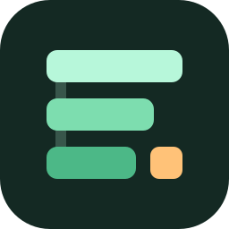

# endstack

Daniel Yang's agent stack: skills for Claude Code and Codex (through T3 Code),
distilled from Lauren Tan's [pstack](https://github.com/cursor/plugins/tree/main/pstack).

**State: six core skills distilled.** Build, babysit, ship, autopilot-stack,
autopilot-full and verify keep implementation, readiness and merge authority
separate. Start with the [command cookbook](docs/cookbook.md) for the full
catalog, copyable prompts, outputs and stopping points. Distribution uses a
reviewed revision selected by homelab sync; global-rule migration remains pending.
[DISTILL.md](DISTILL.md) records the plan, checks and remaining work.

The remaining upstream material is pstack at `cursor/plugins@978ca6e`, with
its `pstack/` history and three linked `cursor-team-kit` skills in
`vendor/cursor-team-kit/`. The original README is
[docs/pstack-readme.md](docs/pstack-readme.md); its guide is
[docs/guide/](docs/guide/README.md). Retained upstream skills are reference
material, not the distilled collection to install wholesale.

## Why not just install pstack

pstack is a Cursor plugin: Cursor-only entry points, Grok and Opus named per
role, a 19 KB always-on mode and 23 playbooks. Daniel works from Codex and
Claude Code inside T3 Code, on several machines, and his providers and tools
update constantly. endstack keeps pstack's ideas (merge is a separate decision
from building, prove it works on the real artifact, a verifier that did not
write the code, short briefings) in a small set of skills phrased as outcomes,
with no exact commands, tool names, model names or harness features, so a
harness update does not break them. Each repository names the skills it uses
in its `AGENTS.md`.

## Install

Install the current homelab CLI from its checkout first (`scripts/homelab install`).
`homelab sync` installs the six distilled skills into `~/.codex/skills` and
`~/.claude/skills`. Homelab's `skill-sources.json` selects an exact reviewed
endstack commit and the six names; source content stays in this repository.
Run `homelab sync --check` afterwards and start a fresh agent session.

The [cookbook](docs/cookbook.md) lists `$build`/`/build` and the other entry
points, installation and update steps, prompts and stopping points.
[Distribution checks](docs/distribution-checks.md) record the tested surface
and remaining limits. First installation requires access to the private source
repository; cached checks work offline.

## License

MIT, as upstream. pstack is © 2026 Lauren Tan ([LICENSE](LICENSE));
the vendored team-kit skills are © 2026 Cursor
([vendor/cursor-team-kit/LICENSE](vendor/cursor-team-kit/LICENSE)).
