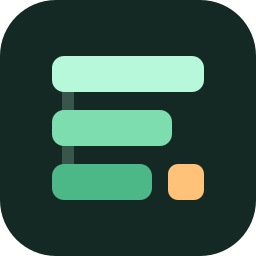

# endstack



Daniel Yang's agent stack: skills for Claude Code and Codex (through T3 Code),
distilled from Lauren Tan's [pstack](https://github.com/cursor/plugins/tree/main/pstack).

**State: five core delivery skills plus 23 role skills.** Build, babysit, ship,
autopilot-full and verify keep implementation, readiness and merge authority
separate. Start with the [command cookbook](docs/cookbook.md) for the full
catalog, copyable prompts, outputs and stopping points. Distribution uses a
reviewed revision selected by homelab sync. Homelab's global rule is now a short
rule plus a gate that stands without the skill (the pointer-only check showed a
bare pointer fails).
[DISTILL.md](DISTILL.md) records the plan, checks and remaining work.

endstack started as a copy of pstack and has since broken from it: upstream is
no longer tracked or fetched. Most pstack skills are now imported (ported to
carry no tool, model or harness names; see the [skills table](#skills) and
`docs/import-notes/`). The few not imported are kept as reference in
[candidates/](candidates/README.md), outside `skills/`. The full pstack copy
(`cursor/plugins@978ca6e`, with its history) is the git tag `pstack-snapshot`.

## Skills

| Group | Skills |
| --- | --- |
| Delivery (core, about 2 KB each) | build, babysit, ship, autopilot-full, verify |
| Explain and think | architect, how, why, correct, ketchup, sharpen |
| Review and process | interrogate, blast-radius, loop-judge, arena, swarm, orchestrate, show-me-your-work, benchmark-checklist, pr-watch, bro |
| Writing and code | technical-writing, unslop, no-comments, typescript-best-practices, test-design, formal-verification |
| Principles | principles (index; each principle is a reference read on demand) |

The role skills are explicit-invocation (`/test-design`, `/arena`, ...), as in
pstack, so they add almost nothing to the catalog the agent sees every session.
`unslop` is the exception: it applies to every reply, and Claude Code agents
skipped it while it was hidden ([evidence](docs/hidden-skill-loads.md)).
What replaces pstack's always-on router is [ROUTING.md](ROUTING.md), an index of about 3 KB
of when to use which skill, installed in the global rules so every turn
sees it ([evidence](docs/routing.md)).

## Dependencies

Design work uses Google's
[Elephant-Goldfish Model](https://github.com/google/elephant-goldfish-model)
plugin (`egm-brainstorm`, `egm-draft`, `egm-review`, `egm-lite` and the rest),
not a copy in `skills/`. [plugins.json](plugins.json) pins it by commit;
homelab installs it beside the skills. Moving the pin means checking the new
revision as [docs/egm-plugin-trial.md](docs/egm-plugin-trial.md) did.

Web UI work uses `gemini-frontend-design` from Google's
[Gemini DemoLab](https://github.com/google-gemini/demolab) plugin, pinned the
same way. The plugin also brings its `deep-research` skill, which ROUTING.md
does not route but agents can still pick up on their own. Why and the eval: [docs/demolab-plugin.md](docs/demolab-plugin.md).

## Why not just install pstack

pstack is a Cursor plugin: Cursor-only entry points, Grok and Opus named per
role, a 19 KB always-on mode and 23 playbooks. Daniel works from Codex and
Claude Code inside T3 Code, on several machines, and his providers and tools
update constantly. endstack keeps pstack's ideas (merge is a separate decision
from building, prove it works on the real artifact, a verifier that did not
write the code, short briefings) in a small set of skills phrased as outcomes,
with no exact commands, tool names, model names or harness features, so a
harness update does not break them. Each repository names the skills it uses
in its `AGENTS.md`.

## Install

Only `skills/` is installable (28 skills); the EGM plugin installs separately
([Dependencies](#dependencies)). Add `-s build -s verify ...` to take a subset.

**With npx** (any machine; installs to Claude Code, Codex, Kiro and other agents):

```sh
npx skills add <path-or-owner/repo> -g -y -a claude-code -a codex -a kiro-cli
```

`<path-or-owner/repo>` is a local checkout, or `endqwerty/endstack` (private,
needs GitHub access). Without `-a`, a non-interactive run installs only to the shared
`~/.agents/skills`, which Claude Code does not read. Add `--copy` to copy instead
of symlinking, and `-s <name>` for a subset (the skills link to each other, so
install `verify` with `build`). Checked with Claude Code's directory layout in a
disposable home; Codex's use of `~/.agents/skills` is not checked. `-a kiro-cli`
writes `~/.kiro/skills`, which the Kiro IDE and CLI both read. Kiro reads only
`name` and `description`, so it lists every skill, the explicit-only ones
included. Do not run this on a machine where
homelab sync already manages these names: both write the same directories.

**On Daniel's machines** use homelab instead. Install its CLI from its checkout
(`scripts/homelab install`); `homelab sync` installs the skills into
`~/.codex/skills` and `~/.claude/skills` from the exact reviewed commit pinned in
homelab's `skill-sources.json`. Run `homelab sync --check` and start a fresh
agent session.

The [cookbook](docs/cookbook.md) lists `$build`/`/build` and the other entry
points, update steps, prompts and stopping points.
[Distribution checks](docs/distribution-checks.md) record the tested surface
and remaining limits. First installation through homelab requires access to the
private source repository; cached checks work offline.

## Checks

```sh
python3 scripts/check-skills.py && python3 scripts/check-routing.py
python3 -m unittest discover -s scripts -p 'test_*.py'
python3 -m unittest discover -s skills/pr-watch/scripts
python3 evals/check-evals.py
```

A skill that bundles a script keeps its tests beside it in `scripts/`; add
its `unittest discover` line here.

## License

MIT ([LICENSE](LICENSE)). Original work is © 2026 Daniel Yang; the skills derived
from pstack keep Lauren Tan's © 2026 notice. The pstack history before
"Start endstack" is Lauren Tan's and Cursor's, kept for attribution.
